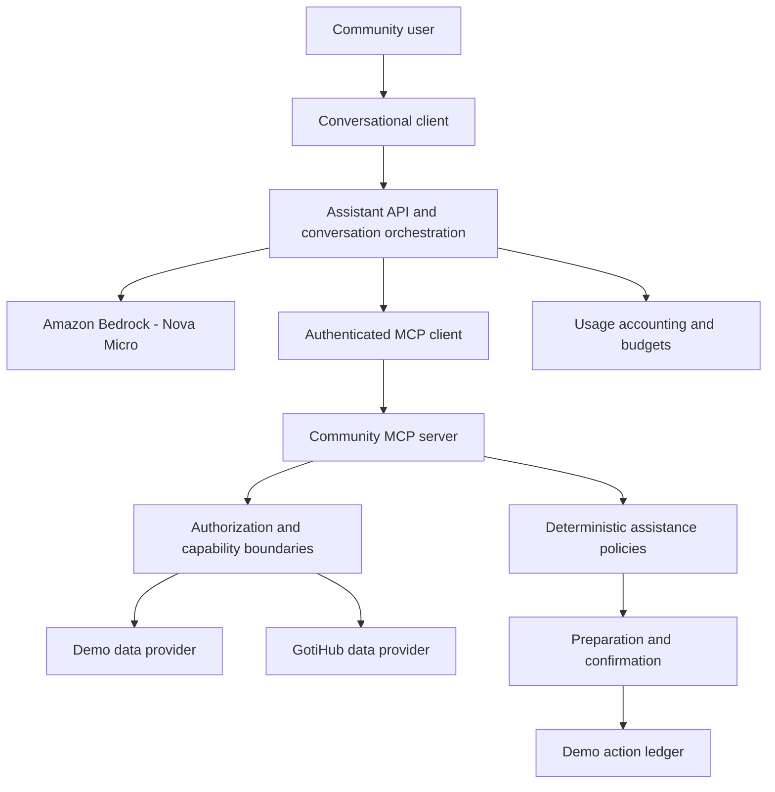

# Community MCP — Architecture Overview

Community MCP provides authenticated, policy-governed capabilities for AI assistants interacting with trusted community applications.

The system separates conversational reasoning, MCP transport, institutional data access, and action authorization.

## Architecture principles

1. **Authoritative information:** Community facts come from configured data providers, not generated assumptions.
2. **Least privilege:** MCP access is authenticated and scoped where authentication is enabled.
3. **Deterministic governance:** Application policies determine which actions are permitted.
4. **Explicit confirmation:** Supported consequential actions require confirmation.
5. **Provider isolation:** Synthetic demonstration data is separated from institutional integrations.
6. **Operational protection:** Usage accounting and configured budgets constrain AI consumption.

## Component architecture

The diagram illustrates logical components, not a single deployment process. The browser simulator and GotiHub Alumni integration have separate deployment and authentication boundaries. The demo action ledger is only used where demo actions are enabled; it is not a production institutional ledger.

## Core components

### MCP server

The MCP server exposes approved community capabilities using the Model Context Protocol, including:

- Event context retrieval.
- Verified assistance context retrieval.
- Controlled demonstration assistance workflows, where enabled.

Production configuration requires authenticated MCP access and public capability mode.

### Conversational orchestration

The assistant interprets questions, maintains temporary conversation context, and invokes MCP capabilities when institutional information is needed.

Amazon Bedrock with Amazon Nova Micro supports AI-powered reasoning. A deterministic alternative supports local demonstrations without AWS credentials.

### Community data providers

Community MCP separates data retrieval from conversational reasoning.

**Demo provider:** Uses synthetic community records for reproducible demonstrations.

**GotiHub provider:** Uses controlled application APIs to retrieve permitted institutional information. The public repository does not contain the private GotiHub Alumni database.

### Assistance governance

Assistance actions are controlled by application policy rather than model-generated decisions. Supported action workflows use preparation, authorization checks, and confirmation before completion. Demonstration action records are isolated from production institutional data.

### Usage controls

The simulator supports SQLite-backed usage accounting and configured limits. The application distinguishes public simulator consumption from authenticated Alumni assistant consumption, with request, token, and concurrency budgets.

## Deployment boundaries

Community MCP supports separate runtime responsibilities:

1. **MCP server:** Provides authenticated capabilities.
2. **Browser simulator:** Provides a public conversational experience using synthetic data.
3. **GotiHub Alumni integration:** Provides an independently deployed institutional application and assistant gateway.

These components should not share unrestricted credentials or bypass their respective authorization boundaries.

## Current limitations

- A verified end-to-end Amazon Alexa+ deployment is not claimed.
- The public simulator uses synthetic community information.
- Institutional integrations expose only approved application capabilities.
- Multi-organization developer connectivity is part of the future roadmap.

## Further reading

- [Security](security.md)
- [Data providers](data-providers.md)
- [Getting started](../guides/getting-started.md)
- [Deployment](../guides/deployment.md)
- [GotiHub Alumni integration](../integrations/gotihub-alumni.md)
